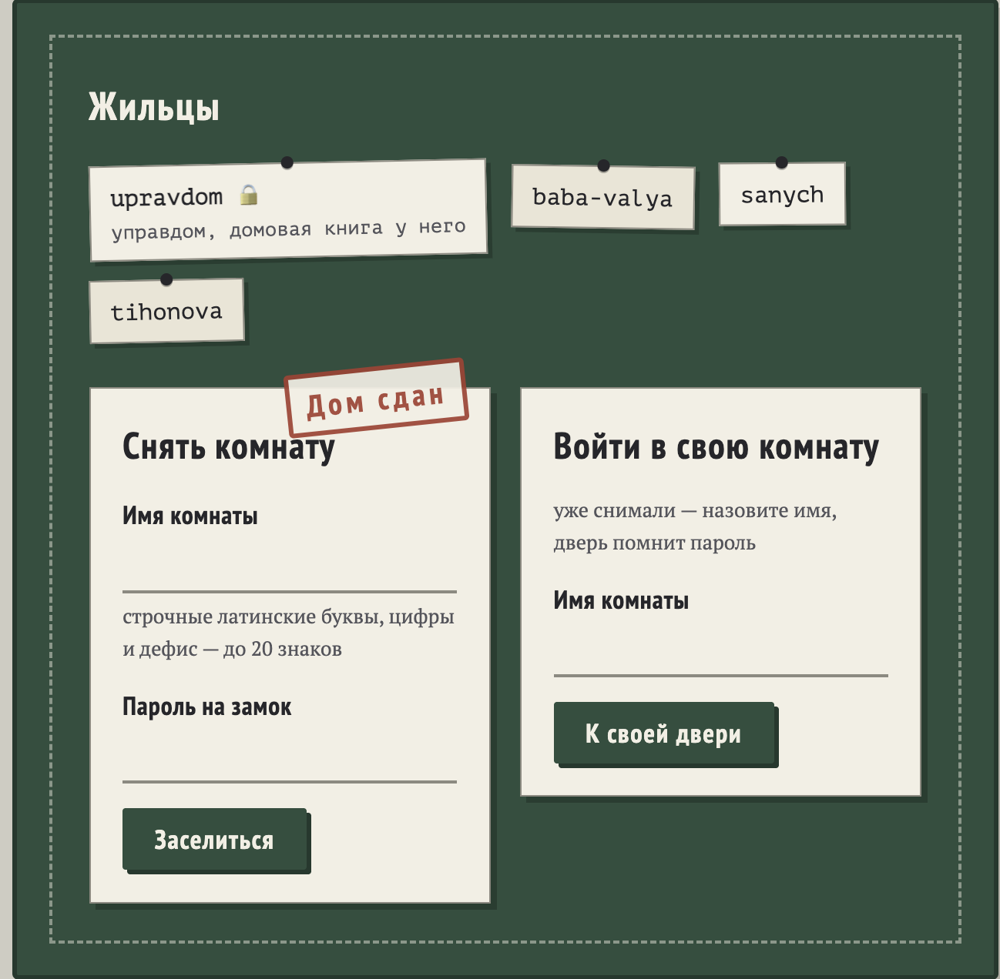
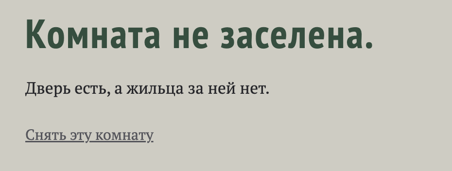
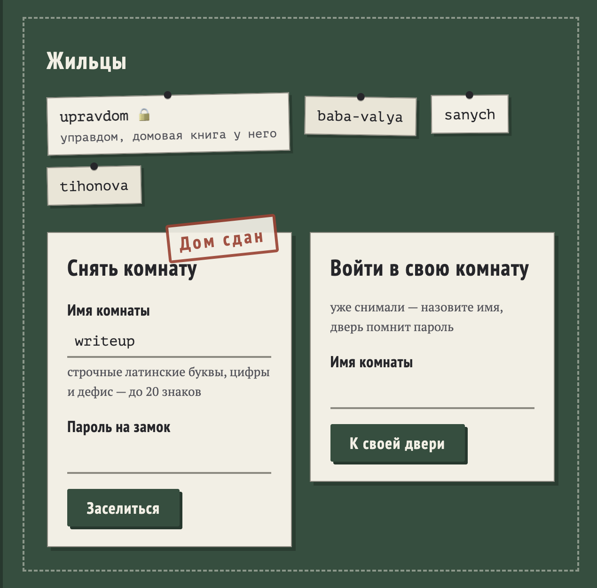
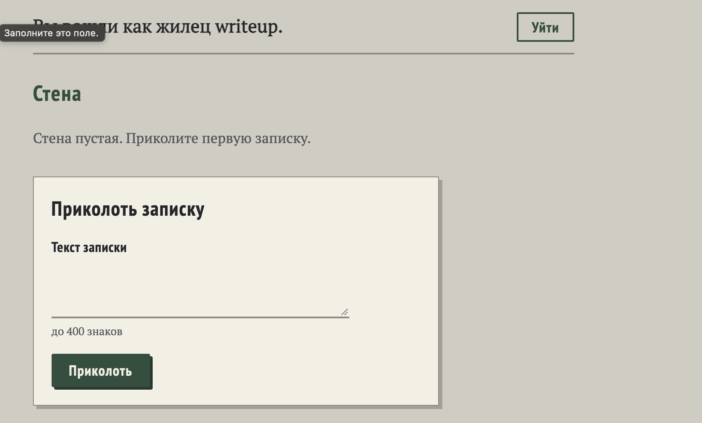
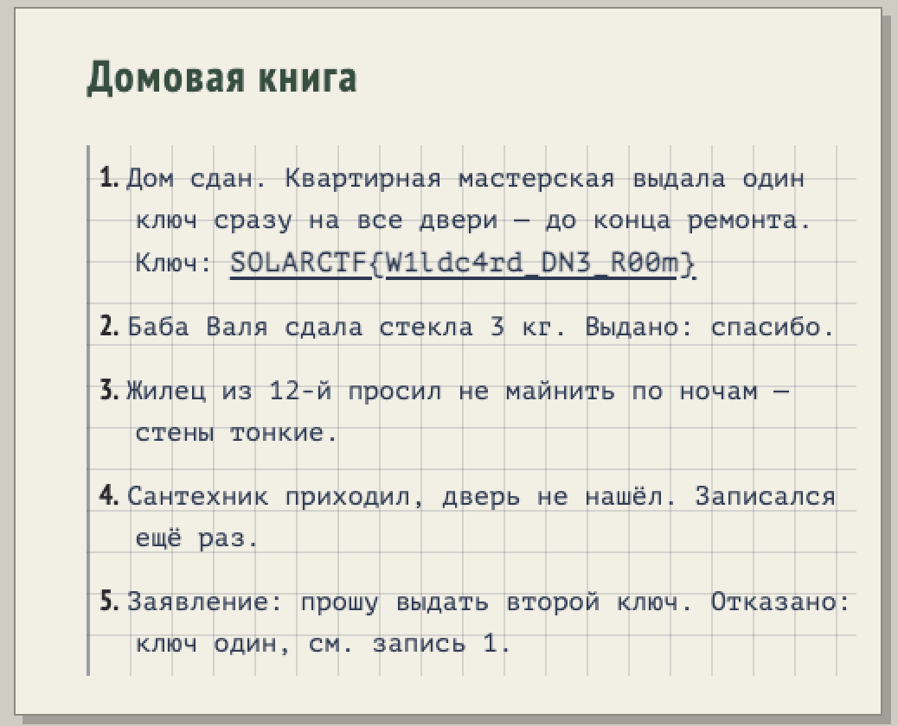

```text
Описание
Старые добрые коммуналки, заходи кто хочешь, бери ключ у управдома и живи сколько хочешь в своей комнатушке. Управдом у нас хороший - с ремонтом поможет, все обо всех знает, а чтобы не забыть ничего важного - в домовую книгу записывает
```
# Разведка и решение
Перейдя на сайт видим прекрасный стенд:

У нас есть две возможности к кому-то заселиться и свою комнату создать. Для начало создадим свою комнату:

Ага, это комната свободная давайте снимем ее. После этого нас перекидывает на начальную страницу, только автоматически заполняет поле комнаты в функции `Снять комнату`.

Дальше решил ввести сложный пароль `12341234`. Потом попросили продублировать пароль и в итоге перекинули на новую страницу `writeup.188.243.222.16.nip.io:30101` .

Сначало я протестил уязвимости SSTI и XSS в записке, но ничего не подтвердилось. Потом я решил проаналезировать cookie - {"r": "writeup"}. Это единственное, что отображается при расшифровки jwt, поэтому перебирать секрет нету смысла, ведь метод шифравания нам не известен. Дальше я обратил внимание на нашу ссылку, где название комнаты использовалось как поддомен. Перешел на ссылку `admin.188.243.222.16.nip.io:30101` и увидел чужие записки. В итоге мы получили IDOR в поддомене, первый раз с таким сталкиваюсь - интересная задумка. Дальше решил побрутить поддомены, но ничего не получилось. Поэтому решил поискать подсказки на главной странице. Попробовал комнату `upravdom`:

# Flag
```text
SOLARCTF{W1ldc4rd_DN3_R00m}
```