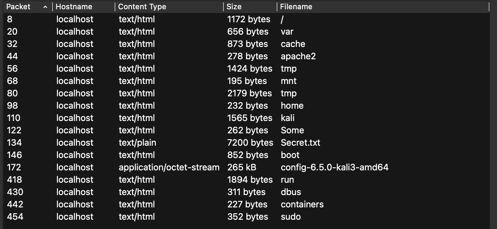

```text
Description:
Привет! На просторах интернета я нашёл дамп трафика из какого-то офиса. Что интересного он может скрывать?
```
# Разведка и решение
Откроем pcap файл и посмотрим какие объекты можно экспортировать.
```text
File -> Export Objects -> HTTP
```

Видим много объектов:


Из необычных файлов мы видим Secret.txt. Посмотрие его содержимое:
```text
Lorem ipsum dolor sit amet, consectetur adipiscing elit. Sed at arcu risus. Aenean eu consequat lacus. Integer sit amet massa ut nulla malesuada vehicula nec dapibus nisi. Aliquam consectetur nulla sit amet ligula sollicitudin, ac dictum mauris vulputate. Mauris ut velit magna. Pellentesque condimentum, felis a elementum ullamcorper, ex risus scelerisque augue, eu luctus neque leo ultrices lorem. Proin consectetur tortor vel viverra congue. Integer quis libero elit. Cras interdum eros nisi, sed porta velit ultricies in. Praesent commodo bibendum nunc, eget accumsan tortor semper non. Pellentesque a mauris id ipsum maximus fringilla eu ut tellus. Quisque in aliquam turpis. Donec pharetra, diam ac facilisis efficitur, sem dui iaculis mauris, vitae pellentesque purus augue eget felis. Praesent quis justo nisl.

...
...
...

Aenean laoreet convallis semper. Proin consequat elit at arcu hendrerit ullamcorper. Quisque lobortis ante quis nisi sagittis sagittis. Vestibulum fringilla augue maximus placerat aliquet. Quisque scelerisque justo quis elit fermentum porttitor at at diam. Phasellus sollicitudin scelerisque turpis at maximus. Aliquam nec pulvinar orci. Pellentesque a ornare dui. Maecenas sed magna euismod, ornare mi in, malesuada nisl. Mauris at elit convallis, venenatis orci nec, pharetra odio. 

CTF{l065_4nd_fr065}

```
В конце файла спрятан файл.
# Flag 
```text
CTF{l065_4nd_fr065}
```
