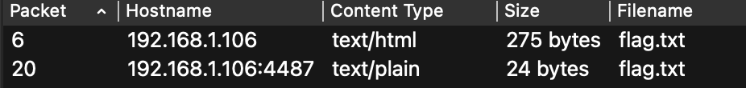

```text
Description:
Use Wireshark
```
# Разведка и решение
Откроем pcap файл и посмотрим какие объекты можно экспортировать.
```text
File -> Export Objects -> HTTP
```

Видим два объекта flag.txt :


Второй файл можем просмотреть:
```text
CTF{its_w1r3sh@rk_fl@g}
```
# Flag
```text
CTF{its_w1r3sh@rk_fl@g}
```