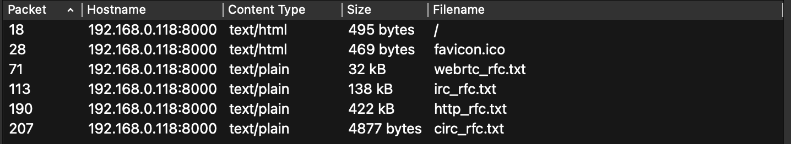

```text
Description:
Нашего агента раскрыли, когда он пытался передать ответы на экзамене. Единственное что у нас есть - pcap файл который мы успели заснифать. Помогите нам узнать, что в этом файле
```
# Разведка
Откроем pcap файл и посмотрим какие объекты можно экспортировать.
```text
File -> Export Objects -> HTTP
```
Видим:


Из всех представленных файлов circ_rfc.txt самый подозрительный из-за его малых размеров. Изучив файл мы понимаем, что это документация к протоколу CIRC.
Найдем пакеты от этого протокола с помощтю фильтра:
```text
tcp contains "CIRC"
или
frame contains "CIRC"
```
Нашли TCP-сессию (порты 46118 ↔ 43211), где идёт обмен сообщениями CIRC.
Соберем все сегменты сессии в один поток с помощью Follow TCP Stream.
```text
Выбираем пакет -> ПКМ -> Follow -> TCP Stream
```
Настройки для сохранения bin файла:
```text
Shaw as Raw
```
Потом сохраняем как bin файл (Save as -> name.bin). 
Теперь пишем код для парсинга bin файла.
```python
import struct, zlib

def parse_circ(data):
    i = 0
    while True:
        i = data.find(b'CIRC', i)
        if i < 0 or i + 20 > len(data):
            break
        magic, crc, sid, mlen, mtype = struct.unpack_from('<4sIIII', data, i)
        if mlen > 1_000_000 or i + 20 + mlen > len(data):
            i += 1
            continue
        msg = data[i+20:i+20+mlen]
        payload = data[i+8:i+20+mlen]
        calc = zlib.crc32(payload) & 0xffffffff
        if calc != crc:
            i += 1
            continue
        yield sid, mtype, msg
        i += 20 + mlen

raw = open('test.bin', 'rb').read()
sessions = {}

for sid, mtype, msg in parse_circ(raw):
    print(f"SID={sid} type={mtype} len={len(msg)} msg={msg[:32].hex()}")
    sessions.setdefault(sid, {})
    if mtype == 2:
        sessions[sid]['fkey'] = msg
    elif mtype == 3:
        sessions[sid]['skey'] = msg
    elif mtype == 4:
        sessions[sid].setdefault('data', []).append(msg)

for sid, s in sessions.items():
    fkey = s.get('fkey')
    skey = s.get('skey')
    if fkey and skey and len(fkey) == 16 and len(skey) == 16:
        shared = bytes(
            [fkey[i] ^ skey[i+8] for i in range(8)] +
            [fkey[i] ^ skey[i-8] for i in range(8, 16)]
        )
        print(f"\nSID {sid} shared key: {shared.hex()}")
        for enc in s.get('data', []):
            dec = bytes(c ^ shared[i % 16] for i, c in enumerate(enc))
            print("DECRYPTED:", dec)
```
Вывод:
```text
SID=1488816818 type=0 len=0 msg=
SID=1488816818 type=1 len=0 msg=
SID=1488816818 type=2 len=16 msg=42a2a4d10fc1bb3dd3cdbd7b70642739
SID=1488816818 type=3 len=16 msg=b345fb88c0e690bdb419cf339c849883
SID=1488816818 type=1 len=0 msg=
SID=1488816818 type=4 len=79 msg=a1de4b91f6204e9e14e7669bd1f4d2a494de0e8cb3205bce0ffb23979ea2e3ec
SID=1488816818 type=4 len=23 msg=b7d50fc2fa3603d714a83496d1eedbfdd6c80a84f67a29
SID=1488816818 type=4 len=15 msg=b9dd4b81fc3051cd05a83f96c3acbd
SID=1488816818 type=4 len=33 msg=b9d045c2d22b479e17e0278790ebc4a499ce19c2fd205bca40fc2781d7e7c3bb
SID=1488816818 type=4 len=42 msg=b5ef2d99e47554e108b831acd4b2e8f1a9dd5a8cf71a13cb54d735c0d3f084f0
SID=1488816818 type=4 len=17 msg=bade1f91b3214c9e09fc68d3f2fbd2aafc
SID=1488816818 type=5 len=0 msg=

SID 1488816818 shared key: f6bb6be2934523be608846f3b082b784
DECRYPTED: b'We seem to have been exposed. Therefore, we are moving to a new cool protocol.\n'
DECRYPTED: b'And is it really safe?\n'
DECRYPTED: b'Of course yes.\n'
DECRYPTED: b'Ok. And what is our next target?\n'
DECRYPTED: b'CTF{w0w_h0w_d0_u_f1nd_0u4_s3cr3ts_dsnadv}\n'
DECRYPTED: b'Lets do it. Bye.\n'
```
На предпоследней строчке видим флаг.
# Flag
```text
CTF{w0w_h0w_d0_u_f1nd_0u4_s3cr3ts_dsnadv}
```