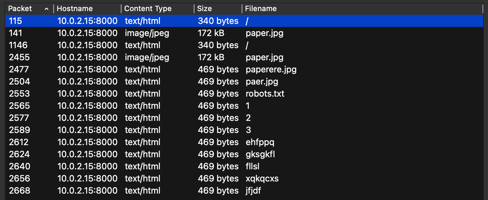
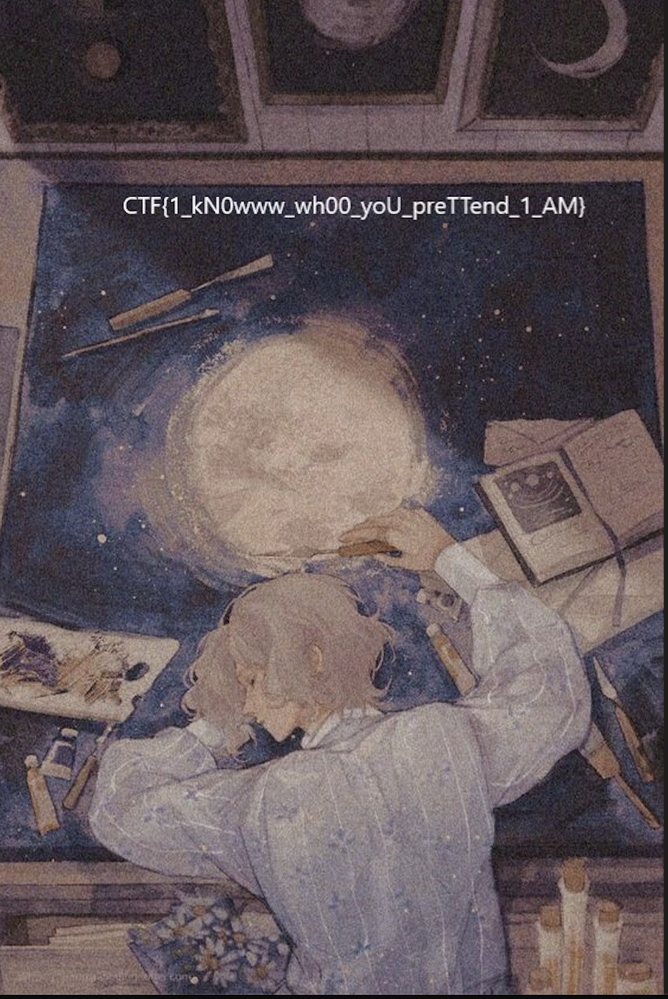

```text
Description:
Кажется, у меня появился тайный поклонник, который посылает мне бумажные самолетики примерно в одно время, из окна противоположного крыла техникума. После некоторого расследования, удалось понять, что в это время, у "КБ 167" идет урок информатики, поэтому мне пришла идея поставить снифферы траффика. Сейчас я забрал .pcap, который показался мне наиболее подозрительным, тем не менее, найти хоть что-то, мне не удалось, может ты сможешь помочь?
```
# Разведка и решение
Откроем pcap файл и посмотрим какие объекты можно экспортировать.
```text
File -> Export Objects -> HTTP
```
Видим:


Откроем картинки и посмотрим, что в них.


# Flag
```text
CTF{1_kN0www_wh00_yoU_preTTend_1_AM}
```
